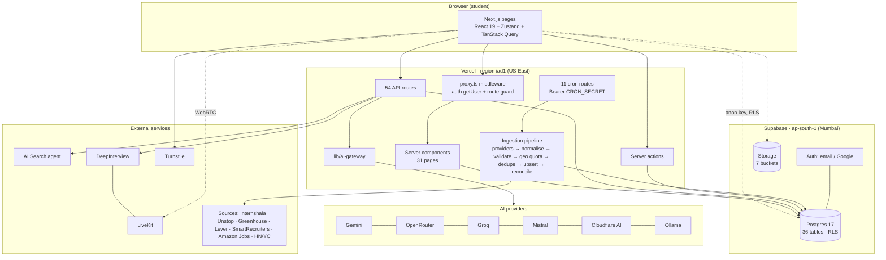
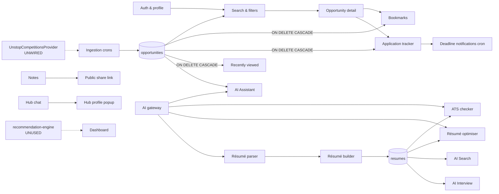

# Opportunity Radar — Complete Audit Report

| | |
|---|---|
| Audit date | 14 November 2026 |
| Code audited | `d9d74e0` on `main`, **identical to the live production deployment** (`dpl_BS8v…`, Vercel) |
| Where | Fresh cloud clone, local production build on `localhost:3000`, read-only access to the production Supabase database |
| Changes made | **None** to code, data, configuration or deployment. Database write probes were always rolled back. Temporary test files were removed. |

Supporting documents (same folder):
- [FEATURE_INVENTORY.md](FEATURE_INVENTORY.md)
- [GITHUB_AND_GIT_AUDIT.md](GITHUB_AND_GIT_AUDIT.md)
- [DATABASE_AND_DATA_QUALITY_AUDIT.md](DATABASE_AND_DATA_QUALITY_AUDIT.md)
- [SECURITY_AUDIT.md](SECURITY_AUDIT.md)
- [AI_FEATURE_AUDIT.md](AI_FEATURE_AUDIT.md)
- [UI_UX_AND_PERFORMANCE_AUDIT.md](UI_UX_AND_PERFORMANCE_AUDIT.md)
- [TESTING_AND_REGRESSION_REPORT.md](TESTING_AND_REGRESSION_REPORT.md)
- [DEAD_CODE_AND_CLEANUP_CANDIDATES.md](DEAD_CODE_AND_CLEANUP_CANDIDATES.md)
- [PRODUCTION_READINESS_ROADMAP.md](PRODUCTION_READINESS_ROADMAP.md)

---

## 1. Executive summary

**Current condition.** The codebase is in better engineering shape than most student projects. It type-checks cleanly, lint has zero errors, 730 unit tests pass, the production build succeeds, security headers are strong, cron endpoints fail closed and no secrets are in git history. Many earlier audit rounds are visible in the commit history.

**The product is not yet trustworthy enough for thousands of students.** The core promise ("a student should never miss an opportunity") is undermined by the **data**, not the code:

| Trust problem | Evidence |
|---|---|
| About 1 in 4 sampled Internshala / Lever / Greenhouse listings is **already closed**, yet shown as live | 20 of 75 checked against authoritative APIs or closed banners; all 20 stored as `link_status=200` |
| **819 Amazon listings show an invented deadline** (always "30 days from now") | `AmazonProvider.ts:104` |
| Date-only deadlines **disappear 18.5 h early** for Indian users (00:00 UTC = 05:30 IST) | 590 rows at 00:00 UTC |
| **65% of "Jobs" are senior roles** (Staff, Principal, Manager, Director …) | 1,267 of 1,951 |
| Search filters return misleading results: "Remote" finds 289 of ~1,399 remote listings; "Paid" finds 16 of 2,921; "Hybrid" and "Workshop" are always empty | SQL against the live RPC |
| Ingestion runs time out before they log or reconcile; **Lever has not refreshed since 2 Nov**; 1,524 published listings are unseen for over 7 days, some since August | `ingestion_logs`, `last_seen_at` |

**Critical blockers (P0):**
1. `next@16.3.8` carries two **unauthenticated RCE** advisories. The upgrade to 16.4.6 is non-breaking.
2. **Broken access control on notes sharing.** Any signed-in user can publish, or (with a second account) read and edit, another user's private note. Proven with rolled-back database tests.
3. **Account deletion leaves personal files behind.** 3 of 6 stored résumé PDFs belong to users who already deleted their accounts. This contradicts the privacy policy.
4. Other vulnerable production dependencies (dompurify critical, undici, zod).

**Production readiness: NOT READY.** It is ready for a small, supervised beta *after* Stage A of the roadmap (≈ 3–4 days). It is ready for broad student use after Stages B–C (≈ 3 weeks).

**Major strengths:** clean architecture with feature folders; a defensive AI gateway (timeouts, budgets, provider fallback, health backoff); a strong anti-fabrication guard on the résumé optimiser; the deterministic ATS score with a hallucination filter; honest UI copy (e.g. email alerts); good duplicate prevention; India-first geo quota (85.5% India); and an excellent public-page experience (LCP < 0.75 s, no layout shift, no overflow at 7 viewports).

**Most important actions:** (1) upgrade Next + dependencies; (2) fix the two notes RLS policies; (3) delete storage on account deletion and purge orphans; (4) stop fabricating deadlines and fix IST handling; (5) detect closed listings via ATS APIs; (6) make ingestion runs complete and observable; (7) fix filters; (8) filter out senior roles; (9) move Vercel functions to Mumbai (`bom1`).

**What this audit could not do (BLOCKED).** Signed-in flows, Google OAuth, and all live AI calls could not be exercised. The environment had no service-role key, no AI keys and no interactive Google login, and no test accounts were created on the production database. These areas were assessed by code review, production telemetry and direct RLS testing instead. Section 11 lists what remains to be run.

---

## 2. Architecture

### 2.1 Technology stack

| Layer | Technology (version) |
|---|---|
| Framework | Next.js **16.3.8** (App Router, Turbopack, `proxy.ts` middleware), React 19.2.4, TypeScript 5 |
| Runtime / package manager | Node 22 (CI and local 22.23.4), npm 10, `package-lock.json` |
| Styling / UI | Tailwind CSS v4, shadcn-style components, Base UI, Material Symbols, Phosphor, framer-motion / motion, GSAP |
| State / forms | Zustand, TanStack Query, TanStack Form, Immer |
| Rich text | TipTap 3 (notes) |
| Résumé builder | Vendored **Reactive Resume** packages (`frontend/packages/*`), `@react-pdf/renderer`, pdfjs, Lingui i18n |
| 3-D | Spline runtime (floating robot), three.js (landing scene) |
| Database / auth / storage | Supabase: Postgres 17 (ap-south-1), Supabase Auth (email+password, Google OAuth, PKCE), Storage (7 buckets); `@supabase/ssr` |
| AI | In-house gateway → Gemini (`gemini-flash-latest`), OpenRouter (`gemini-2.5-flash`), Groq (`llama-3.3-70b`), Mistral (`mistral-small`), Cloudflare Workers AI (`llama-3.1-8b`), Ollama (`gpt-oss:120b`, `nemotron`) |
| External services | AI Search agent (`AI_AGENT_URL`), DeepInterview service (`INTERVIEW_AGENT_URL`) + LiveKit (voice), Cloudflare Turnstile |
| Scraping | cheerio, node-html-parser, provider classes in `frontend/src/providers/opportunities` |
| Hosting / jobs | Vercel (functions in `iad1`), 11 Vercel crons in `vercel.json` |
| Testing | Vitest 4 (unit), Playwright 1.62 (e2e, 3 specs) |
| CI | GitHub Actions: `npm ci`, type-check, unit tests, lint |
| Monitoring | Console logs plus `ingestion_logs` / `ai_usage_log` tables; Sentry is mentioned in `.env.example` but not installed |

### 2.2 System architecture diagram

### 2.3 Feature dependency diagram

### 2.4 Architectural issues

- **Region mismatch:** functions in `iad1`, database in `ap-south-1`. Every server-side DB call crosses continents.
- **Two ATS engines:** `lib/ats-engine` (v1, behind the orphaned `/api/ats/analyze`) and `lib/ats-checker` + `ats-v2-intelligence` (live).
- **Two résumé builders:** `features/resume-toolkit/components/{engine,builder}` (dead) and `features/resume` + `packages/*` (live).
- **Abandoned queue architecture:** `QueueProducer` / `QueueConsumer` and `ingestion_queue` (0 rows), while crons run monolithic pipelines that exceed their time limit.
- **Destructive coupling:** hard-deleting opportunities cascades into user data (bookmarks, saved tracker cards).
- **Service-role usage in 27 files.** It is confined to the server, but RLS is the real boundary, and two policies are wrong.
- **Out-of-repo dependencies:** two critical features (AI Search, AI Interview) depend on services outside this repo.
- No circular-dependency problems surfaced in the type-check or build.

---

## 3. GitHub and version control

The local clone, GitHub `main` and production are **all at `d9d74e0`**: 0 ahead, 0 behind, clean working tree, 371 commits, no secrets in history. Commit messages are good. Concerns: there have been **no commits for 5 weeks**, the **database migrations have drifted** from the repo (18 unrecorded, 2 missing, 1 never applied), and CI lacks build, e2e and audit steps. Because this is a cloud clone, anything that exists only on the developer's laptop is unknown. → [GITHUB_AND_GIT_AUDIT.md](GITHUB_AND_GIT_AUDIT.md)

## 4. Feature inventory

31 pages, 54 API routes, 11 crons, 36 tables, 7 buckets. Public pages are **PASS**. Signed-in features are mostly **BLOCKED** for execution, but have code, DB and telemetry evidence. Key statuses:
- **FAIL:** search filters (Remote, Paid, Hybrid, Workshop); note sharing (security); account deletion (storage); deadlines (fabricated, timezone); link freshness; Lever and YC ingestion; Unstop competitions (never wired).
- **PARTIAL:** keyword search (no synonyms or description search); Internshala, Unstop and ATS ingestion (incomplete runs); dashboard (not personalised); privacy policy.
- **UI-only:** email alerts toggle, public-profile toggle.
- **Orphaned:** 4 API routes.
- **Dead:** old résumé engine/builder (27 files).
→ [FEATURE_INVENTORY.md](FEATURE_INVENTORY.md)

## 5. Database and data quality

- RLS is on for all 36 tables and is mostly correct; profile role escalation is blocked by a trigger.
- **Two confirmed RLS holes** (notes sharing).
- Storage orphans after deletion.
- **Public `note-attachments` bucket allowing SVG.**

Data: 4,759 opportunities, of which 2,963 are published (85.5% India). Field completeness is poor: `experience_level` and `employment_type` are 100% NULL, `mode` 90%, `is_paid` 99%, `salary` 74%. Duplicates are well controlled (5 same-title pairs, of which 2 are likely true duplicates). Deadline and freshness problems are as summarised above. Link verification on 150 links found 20 closed, all marked live. → [DATABASE_AND_DATA_QUALITY_AUDIT.md](DATABASE_AND_DATA_QUALITY_AUDIT.md)

## 6. Authentication

| Item | Status | Evidence |
|---|---|---|
| Route protection (middleware) | PASS | 307 → `/login?next=…` |
| API auth checks | PASS | 401 on unauthenticated calls; auth is checked before body validation |
| OAuth callback error handling and open-redirect guard | PASS | `safeNextPath`, OTP type allow-list, tested |
| Google sign-in end-to-end | **BLOCKED** | Requires interactive consent. Also check that the Supabase Auth redirect allow-list contains `http://localhost:3000/auth/callback`; local `config.toml` lists only `127.0.0.1` |
| Email signup name | **FAIL** | Production trigger ignores `full_name` (unapplied migration) |
| Password policy | Weak | 6 characters; leaked-password protection off |
| Session cookies / refresh | Reviewed | `@supabase/ssr` pattern; `getUser()` on every request; regression test `session-cookie-readable` passes |
| Role escalation | PASS | `protect_profile_fields` trigger |
| User isolation (RLS) | **PARTIAL** | Correct for all user tables **except notes sharing** |
| Rate limiting / bot protection | Implemented | `login_attempts`, Turnstile (both optional via env); not exercised |

## 7. AI features

No live AI call could be made (BLOCKED). Production telemetry shows **no AI usage since 9 Oct**, latency outliers up to **124 s**, 2 assistant failures at the 45 s budget, and **zero completed voice interviews ever recorded**.

Design strengths:
- assistant listings come only from the database (no hallucinated jobs by construction);
- the fabrication guard on the optimiser;
- deterministic ATS scoring over guarded evidence.

Gaps:
- no "estimate" disclaimer on the ATS score;
- the assistant cannot read the user's résumé;
- JD and résumé text enter prompts without isolation;
- the rate limiter fails open;
- the privacy policy omits Cloudflare and Ollama and the external agents.
→ [AI_FEATURE_AUDIT.md](AI_FEATURE_AUDIT.md)

## 8. UI/UX

All 7 public routes passed at 7 viewports: no overflow, no console errors, labelled controls. Minor: the 320 px header wraps. The signed-in UI could not be rendered. The major UX problems are data-driven: filters that empty the results, invented or early deadlines, closed links, senior roles, a non-personalised dashboard, and silent disappearance of saved items. → [UI_UX_AND_PERFORMANCE_AUDIT.md](UI_UX_AND_PERFORMANCE_AUDIT.md)

## 9. Performance

| Measure | Result |
|---|---|
| Public pages (localhost prod build) | FCP 124–436 ms, LCP 132–720 ms, CLS ≤ 0.044, 211–357 KB JS |
| Search RPC from this sandbox | p50 815–945 ms, p95 ≤ 1.18 s (mostly network) |
| Search DB execution | **165 ms** (double CTE, ILIKE, FTS index unused) |
| Largest client chunks | 8.4 MB (three/yoga/react-pdf), 1.9 MB (Spline/three); `public/` 13 MB |

Biggest real-world win: **move functions to `bom1`** (next to the DB and the users). → [UI_UX_AND_PERFORMANCE_AUDIT.md](UI_UX_AND_PERFORMANCE_AUDIT.md)

## 10. Security

1 Critical (Next RCE advisories), 4 High (two note-sharing RLS holes, storage left after deletion, vulnerable deps), 6 Medium (Hub email disclosure, public note attachments, fail-open AI rate limiter, orphaned endpoints, migration drift, destructive cascades), 7 Low. No secrets exposed; headers strong; cron auth sound; XSS probe on scraped descriptions neutralised. → [SECURITY_AUDIT.md](SECURITY_AUDIT.md)

## 11. Testing

Unit tests 730/730 PASS; type-check PASS; lint 0 errors / 131 warnings; build PASS (with env); e2e 4/4 PASS but signed-out only. **55 test files never run** (vitest `include` mismatch). No RLS behaviour tests, which is why the notes holes slipped through.

This audit's checks: 23 executed (14 PASS, 9 FAIL). 20-scenario matrix: 3 FAIL, 4 PARTIAL, 13 BLOCKED. Still to run: signed-in e2e against a **staging** Supabase project, Google OAuth on localhost, and the AI evaluation script with keys. → [TESTING_AND_REGRESSION_REPORT.md](TESTING_AND_REGRESSION_REPORT.md)

## 12. Cleanup candidates

~120 files and ~6–7 MB removable:
- dead résumé engine/builder (12 unsafe HTML sinks);
- duplicate ATS engine and 4 orphaned routes;
- unused vendored components;
- 4.5 MB of unreferenced template PDFs;
- unused deps (`dompurify`, `fast-json-patch`, `@phosphor-icons/web`, `@typescript/native-preview`, `shadcn`).

**Keep and wire in:** `recommendation-engine`, `UnstopCompetitionsProvider`. **Add** the Reactive Resume licence notice. → [DEAD_CODE_AND_CLEANUP_CANDIDATES.md](DEAD_CODE_AND_CLEANUP_CANDIDATES.md)

## 13. Requirement fulfilment vs. vision

| Vision element | Status |
|---|---|
| "Never miss an opportunity" | **Partially met.** Breadth exists (~2.9k live), but ~25% closed links and early-expiring deadlines mean students *do* miss or waste effort |
| Jobs, internships, hackathons, scholarships, competitions, workshops | Jobs and internships covered; hackathons modest (123); **competitions 13, scholarships 2, workshops 0** |
| Accurate, current, actionable | **Not met yet:** fabricated deadlines, stale and closed rows, 65% senior jobs |
| India-first | **Met** (85.5% India; 15% international cap enforced) |
| Relevant (personalised) | **Not met:** dashboard identical for everyone; recommendation engine unused |
| Secure and private | **Not met until P0 fixes** |
| Fast | Public pages fast; server path slowed by the cross-continent region |
| Useful AI | Well-designed but **unverified for 5 weeks**, with high latency tails |

More features have been built than the data layer can currently support. The highest-value work is making the existing catalogue **true**, not adding features.

## 14. Prioritised remediation plan (summary)

| ID | Issue | Severity | Priority | Effort |
|---|---|---|---|---|
| R-01 | Upgrade Next.js (RCE advisories) | Critical | P0 | S |
| R-02/03 | Notes sharing RLS ownership checks | High | P0 | S |
| R-04 | Delete storage on account deletion; purge orphans | High | P0 | M |
| R-05 | Upgrade or remove vulnerable deps | High | P0 | S |
| R-06/07 | Hub email exposure; private note attachments | Medium | P1 | S / M |
| R-08/09 | No fabricated deadlines; IST end-of-day | High | P1 | S |
| R-10 | Detect closed listings via ATS APIs / banners | High | P1 | M |
| R-11 | Ingestion that completes, logs, reconciles, alerts | High | P1 | L |
| R-12 | Fix or hide broken filters | High | P1 | S |
| R-13 | Filter senior roles from the student feed | High | P1 | M |
| R-14 | Soft-expire bookmarked/tracked listings | Medium | P1 | M |
| R-15 | Apply missing migration; repair history | Medium | P1 | M |
| R-16 | Vercel region `bom1` | Medium | P1 | XS |
| R-17 | Privacy policy corrections + DPDP legal review | Medium | P1 | S |
| R-18 | Verify AI with keys; schedule health check | Medium | P1 | M |
| R-19 … R-35 | Personalisation, sources, rate limiter, latency, search, DB perf, cleanup, tests, polish | Low–Medium | P2–P3 | — |

The full table, with dependencies and a staged plan (Stages A–F), is in [PRODUCTION_READINESS_ROADMAP.md](PRODUCTION_READINESS_ROADMAP.md).

## 15. Final assessment

1. **What is genuinely working?**
   - Build, type-check, 730 unit tests.
   - Public pages at all viewports.
   - Route and API auth guards; cron auth.
   - Keyword search basics (case, multi-word, injection-safe).
   - Duplicate prevention; India-first quota; nightly Amazon and maintenance jobs.
   - Security headers.
   - Description sanitisation.
   - Profile role protection.
   - RLS on all user tables except notes sharing.
2. **What only appears to work?**
   - Remote/Paid/Hybrid/Workshop filters.
   - `link_status = 200` "verified" links (a quarter are closed).
   - Amazon deadlines.
   - "Daily new opportunities" (most runs time out).
   - Dashboard "recommendations".
   - Email-alert and public-profile toggles.
   - The e2e suite, which passes without signing in.
3. **What is broken?**
   - Notes sharing access control.
   - Storage cleanup on account deletion.
   - Lever refresh (since 2 Nov) and the YC provider.
   - Signup display-name capture.
   - Date-only deadline timezone.
   - Unstop competitions ingestion (never wired).
4. **What has not been tested?**
   - All signed-in UI flows and Google OAuth.
   - Every live AI response.
   - AI Search and the voice interview (external services).
   - Uploads with real files.
   - Keyboard and screen-reader use of signed-in pages.
   - Production Auth settings.
5. **What information is inaccurate or unverified?**
   - 819 fabricated deadlines; 590 early-expiring deadlines.
   - ~25% closed links in three sources.
   - 100%-NULL experience and employment type.
   - Privacy policy statements on providers, Hub visibility and deletion.
   - SmartRecruiters and Unstop liveness (likely live, not confirmable from HTML).
6. **What security risks exist?**
   - Next RCE advisories.
   - Notes RLS holes.
   - Orphaned personal files.
   - Hub email disclosure.
   - Public note attachments with SVG.
   - Vulnerable deps.
   - Fail-open AI rate limiting.
   - Orphaned AI endpoints.
   - Weak password policy.
7. **What is slowing the application?**
   - US-East functions talking to a Mumbai database.
   - The search RPC design.
   - The 3-D robot on every signed-in page.
   - Gemini latency tails in ATS and parsing.
   - Large images.
8. **Which features should be retained?**
   - Search and filters (after fixes), opportunity detail, bookmarks, tracker.
   - ATS checker, résumé optimiser and builder.
   - Assistant (DB-grounded), certifications catalogue, notes (after the RLS fix).
9. **What should be improved?**
   - Data truth (deadlines, closures, seniority, completeness).
   - Ingestion reliability and observability.
   - Personalisation; competition and scholarship coverage.
   - AI latency; privacy-policy accuracy.
10. **What code should be removed?**
    - Dead résumé engine/builder; duplicate ATS v1 engine.
    - 4 orphaned API routes; unused vendored UI.
    - Unreferenced template PDFs; unused deps.
    - These all need approval. **Reconsider** (do not silently delete) the voice interview: it has never recorded a completed session in production and depends on two external services.
11. **What must be fixed before production?**
    - R-01 to R-05 (P0).
    - R-08 to R-12 (P1 trust: deadlines, closed links, ingestion, filters).
    - R-17 (privacy policy accuracy).
12. **Is the original vision being fulfilled?**
    - **Not yet.** The platform is broad and well engineered.
    - It does not yet reliably give students *accurate, current, relevant and actionable* opportunities.
    - The path there is mostly data-pipeline and trust work (about 3 weeks of focused effort per the roadmap), not new features.

---

*Next step: review this report and approve which roadmap stages to execute. No destructive cleanup, database write, migration or deployment will happen without explicit approval.*
